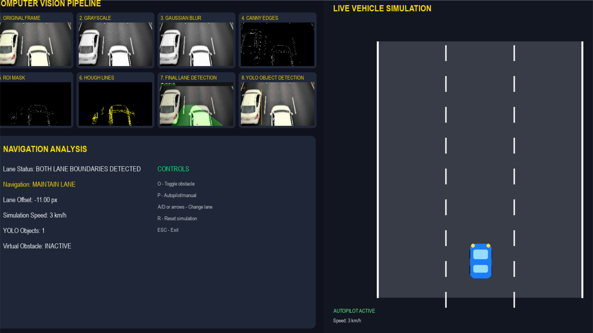

# 🚗 AI Lane Keeping Navigation Assistant

An AI-powered lane detection and navigation assistant that uses computer vision and YOLO object detection to analyze road environments, detect lanes, identify obstacles, and support intelligent vehicle navigation.

The project aims to simulate an intelligent driving assistant that can recognize road lanes and respond to obstacles by selecting an appropriate driving path.

## 📌 Project Overview

The **AI Lane Keeping Navigation Assistant** combines computer vision, deep learning, and video processing to understand road environments.

The system processes road videos, detects objects using the YOLO object detection model, and analyzes lane positions to support lane-aware navigation and obstacle avoidance.

### 🎯 Objectives

- Detect road lanes using computer vision.
- Identify vehicles and other objects using YOLO.
- Analyze the road environment in real time.
- Detect obstacles in the vehicle's path.
- Support automatic lane selection and obstacle avoidance.
- Build a foundation for intelligent autonomous driving systems.

## ✨ Key Features

- **Lane Detection:** Identifies road lanes and estimates lane positions.
- **YOLO Object Detection:** Detects objects in road environments using YOLOv8.
- **Obstacle Detection:** Identifies objects that may obstruct the vehicle's path.
- **Lane Analysis:** Analyzes available lanes to determine a suitable driving path.
- **Navigation Assistance:** Supports automatic navigation decisions based on detected road conditions.
- **Video Processing:** Processes road and driving videos for testing and simulation.

## 🛠️ Technologies Used

| Technology | Purpose |
|---|---|
| Python | Core programming language |
| OpenCV | Image and video processing |
| YOLOv8 | Object detection |
| NumPy | Numerical operations |
| Computer Vision | Lane and road analysis |
| Deep Learning | Object recognition |

## 📂 Project Structure

```text
AI-Lane-Keeping-Navigation-Assistant/
│
├── videos/
│   ├── drive.mp4
│   └── mixkit-cars-driving-by-on-road-2022-hd-ready.mp4
│
├── main.py
├── lane_detection.py
├── yolo_detector.py
├── test_yolo.py
│
├── yolov8n.pt
├── requirements.txt
│
├── .gitignore
└── README.md
```

### 📄 File Descriptions

| File | Description |
|---|---|
| `main.py` | Main application entry point and navigation logic. |
| `lane_detection.py` | Contains lane detection functionality. |
| `yolo_detector.py` | Handles YOLO-based object detection. |
| `test_yolo.py` | Used for testing YOLO object detection. |
| `yolov8n.pt` | Pre-trained YOLOv8 Nano model weights. |
| `requirements.txt` | Contains project dependencies. |
| `videos/` | Contains road and driving videos used for testing. |

## ⚙️ Installation and Setup

### 1. Clone the Repository

```bash
git clone https://github.com/RahulUbale06/AI-Lane-Keeping-Navigation-Assistant.git
```

### 2. Navigate to the Project Directory

```bash
cd AI-Lane-Keeping-Navigation-Assistant
```

### 3. Create a Virtual Environment

```bash
python -m venv .venv
```

### 4. Activate the Virtual Environment

**Windows:**

```bash
.venv\Scripts\activate
```

### 5. Install Dependencies

```bash
pip install -r requirements.txt
```

### 6. Run the Application

```bash
python main.py
```

## 🧠 How It Works

The project follows a computer vision-based processing pipeline:

```text
        Road Video Input
               |
               v
       Frame Extraction
               |
        +------+------+
        |             |
        v             v
   Lane Detection   YOLO Detection
        |             |
        v             v
   Lane Analysis   Object Analysis
        |             |
        +------+------+
               |
               v
       Navigation Logic
               |
               v
      Driving Path Decision
               |
               v
       Visual Output
```

### Processing Stages

1. **Video Input:** Reads frames from the selected road video.
2. **Frame Processing:** Processes individual frames using OpenCV.
3. **Lane Detection:** Identifies lane boundaries and lane positions.
4. **Object Detection:** Uses YOLOv8 to identify vehicles and other objects.
5. **Environment Analysis:** Evaluates detected lanes and objects.
6. **Navigation Decision:** Determines a suitable driving path based on the available information.
7. **Output:** Displays the processed road environment and detection results.

## 📸 Project Screenshots




## 🚀 Future Improvements

- Improve lane detection accuracy under different lighting conditions.
- Implement more reliable obstacle distance estimation.
- Integrate traffic sign and traffic signal recognition.
- Improve lane-changing decision logic.
- Add vehicle speed estimation.
- Explore real-time camera input.
- Develop a more advanced autonomous driving simulation.

## 👨‍💻 Developer

**Rahul Ubale**

B.Tech Student | Artificial Intelligence & Data Science | AI/ML & Software Development Enthusiast

- GitHub: [@RahulUbale06](https://github.com/RahulUbale06)
- Portfolio: [My Portfolio](https://rahul-portfolio-snowy-six.vercel.app/)

---

⭐ If you find this project interesting, consider giving the repository a star!

**Building intelligent systems, one project at a time.** 🚀